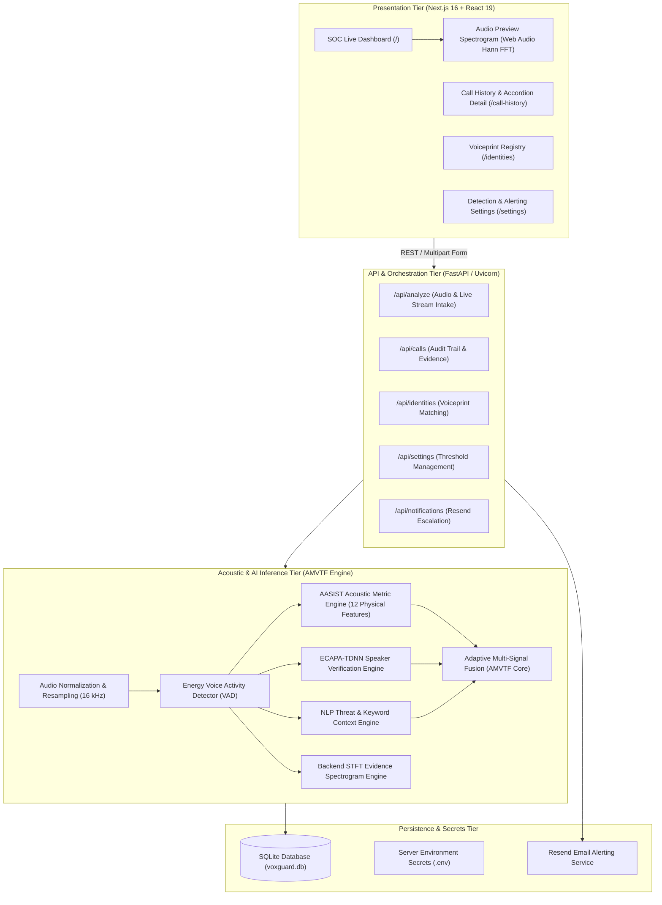

# VoxGuard AI — System Architecture

## 1. System Overview & Problem Statement
With the rise of advanced neural vocoders (HiFi-GAN, WaveGlow, Diffusion-based acoustic models) and zero-shot voice cloning APIs (ElevenLabs, Bark, Tortoise, VALL-E), voice spoofing attacks against corporate financial verification, remote authentication, and telecommunications fraud have escalated exponentially.

**VoxGuard** is an enterprise-grade biometric security system designed to authenticate speech in real time. It detects acoustic artifacts of artificial synthesis, verifies speaker biometrics against consented voiceprints, analyzes conversational context for social engineering threats, and provides defensible visual evidence for forensic audits.

---

## 2. Multi-Tier System Topology

---

## 3. Core Subsystem Responsibilities

### A. Dual-Spectrogram Architecture
1. **Client Preview Spectrogram**:
   - Location: `echoguard/src/components/AudioPreviewSpectrogram.tsx`
   - Calculation: In-browser Web Audio API `AudioContext.decodeAudioData`.
   - Resolution: 512-point Hann window, 256-point hop length.
   - Purpose: Immediate visual confirmation to the user upon file selection. Completely decoupled from backend inference; zero database mutation or alert generation.
2. **Backend Analysis Evidence Spectrogram**:
   - Location: `backend/engines/spectrogram.py`
   - Calculation: `scipy.signal.stft` computed from normalized 16 kHz audio buffer passed to the model.
   - Resolution: Standardized STFT with decibel magnitude mapping `[-80 dB, 0 dB]`, Magma colormap.
   - Purpose: Cryptographic and evidentiary record saved to the SQLite `calls` table (`spectrogram_data` and `spectrogram_metadata`).

### B. Adaptive Multi-Signal Voicetagging Fusion (AMVTF)
Rather than relying on a single fallible score, VoxGuard computes an adaptive fused risk score:
$$\text{FusedRisk} = w_{\text{auth}} \cdot (1 - \text{Authenticity}) + w_{\text{id}} \cdot (1 - \text{IdentityMatch}) + w_{\text{ctx}} \cdot \text{ContextRisk}$$

Default Weights:
- $w_{\text{auth}} = 0.50$ (Physical acoustic spoofing probability)
- $w_{\text{id}} = 0.30$ (Biometric speaker mismatch penalty)
- $w_{\text{ctx}} = 0.20$ (Social engineering / urgency threat keywords)

### C. Automated Incident Escalation Engine
- Trigger: Persisted analysis resulting in `verdict = 'CRITICAL'` or `fusedRiskScore >= 0.70`.
- Delivery: Server-side Resend API dispatching responsive HTML security advisories to verified SOC responders.
- Safe Fallback: Built-in local Demo Relay logs the accepted email payload to console when `RESEND_API_KEY` is a placeholder.

---

## 4. Academic Reference Links
- [[data-flow|Data Flow Pipeline]]
- [[model-card|AASIST/AMVTF Model Card]]
- [[database-schema|Database Schema Documentation]]
- [[evaluation|Benchmark Evaluation Report]]
- [[viva-preparation|B.Tech Viva Defense Guide]]
