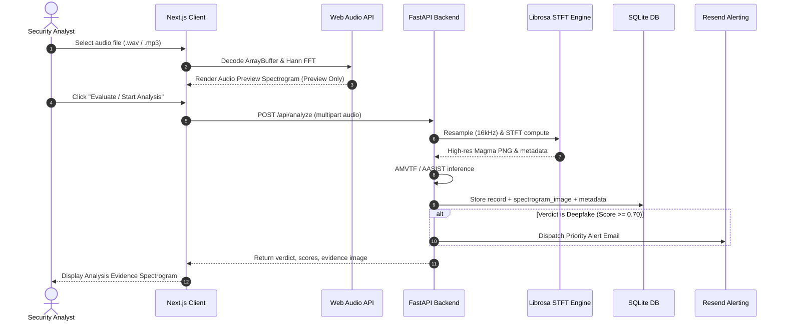

# Audio Analysis & Forensic Pipeline

VoxGuard employs a strict dual-mode acoustic pipeline to ensure instant client feedback while preserving evidentiary integrity for security operations.

## Pipeline Specifications

### 1. Client Preview Spectrogram
- **Component**: `echoguard/src/components/AudioPreviewSpectrogram.tsx`
- **Engine**: Browser Web Audio `AudioContext.decodeAudioData`
- **Window**: 512-point Hann FFT, 256-point hop length
- **Colormap**: Magma (perceptually linear from black to magenta to bright yellow)
- **Constraint**: Purely client-side; zero API requests, database rows, or email alerts.

### 2. Backend Analysis Evidence Spectrogram
- **Component**: `backend/engines/spectrogram.py`
- **Engine**: Librosa STFT / Matplotlib Agg
- **Resolution**: 1024/2048-point FFT, 512-point hop, 16 kHz standardized sampling
- **Persistence**: Stored in `calls` table (`spectrogram_image` base64 PNG + `spectrogram_meta` JSON).

## Related Documents
- [[system-overview|System Architecture Overview]]
- [[database-schema|Database Schema Reference]]
- [[../ui/page-hierarchy|UI Page Hierarchy]]
