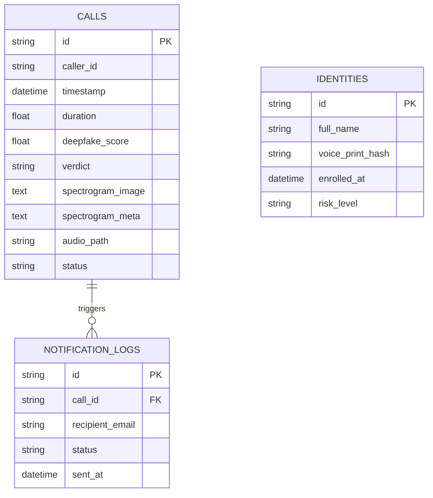

# Database Schema Reference

The VoxGuard database stores call logs, identity profiles, deepfake detection metrics, evidentiary spectrograms, and notification delivery history.

## Entity Relationship Diagram

## Table Specifications

### `calls` Table
- `id` (TEXT, PK): Unique UUID or safe call identifier.
- `caller_id` (TEXT): Phone number, SIP URI, or uploaded filename.
- `timestamp` (DATETIME): Time of ingestion/inference.
- `deepfake_score` (REAL): Model synthetic confidence `[0.0, 1.0]`.
- `verdict` (TEXT): Classification outcome (`AUTHENTIC`, `SUSPICIOUS`, `DEEPFAKE`).
- `spectrogram_image` (TEXT): Base64 data URI of the backend-generated analysis spectrogram.
- `spectrogram_meta` (TEXT): JSON containing sample rate, FFT size, hop length, time range, frequency range.

## Related Documents
- [[audio-analysis-pipeline|Audio Analysis Pipeline]]
- [[../development-tooling|DBHub Tooling]]
