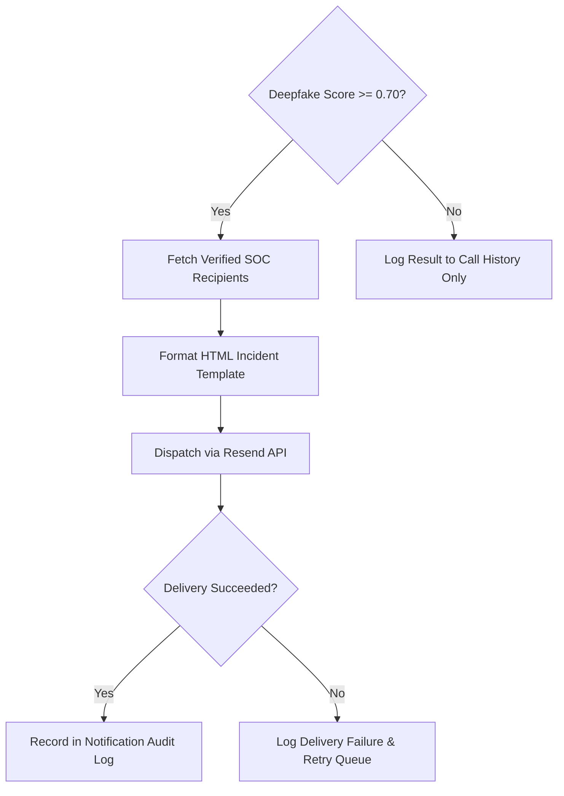

# Notification & Incident Alerting System

VoxGuard provides automated incident escalation via the Resend email engine when a deepfake attack is detected during live call monitoring or file evaluation.

## Alerting Flow

## Configuration Parameters
- `RESEND_API_KEY`: API authentication key.
- `ALERT_FROM_EMAIL`: Verified sender email domain.
- `ALERT_TO_EMAIL`: Default destination for urgent SOC incident alerts.

## Related Documents
- [[system-overview|System Architecture Overview]]
- [[../ui/page-hierarchy|Settings & Recipients Page]]
