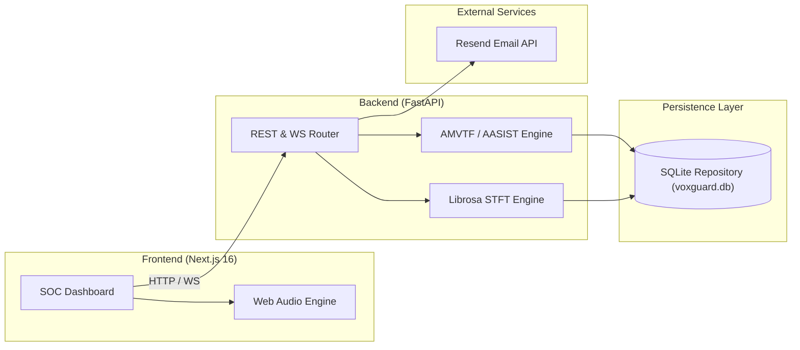

# System Architecture Overview

VoxGuard AI is an enterprise-grade biometric security and synthetic media defense platform. It protects telecommunications channels, audio recordings, and voice authentication workflows from deepfake audio attacks and caller impersonation.

## Architecture Diagram

## Related Documents
- [[audio-analysis-pipeline|Audio Analysis & Forensic Pipeline]]
- [[database-schema|Database Schema Reference]]
- [[notification-system|Notification System]]
- [[../ui/page-hierarchy|UI Page Hierarchy]]
