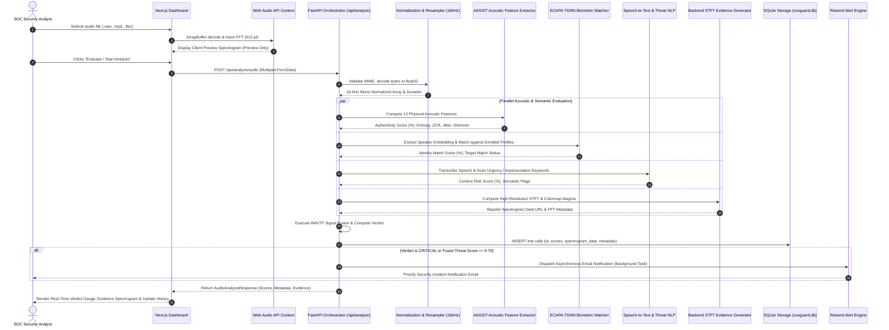

# VoxGuard AI — End-to-End Data Flow Pipeline

## 1. Complete Audio Ingestion & Analysis Sequence



---

## 2. Ingestion Stages & Mathematical Transforms

### Stage 1: Audio Validation & Normalization
- **Input**: Raw uploaded byte stream `B \in \{0, \dots, 255\}^N`.
- **Validation**: Enforce valid audio containers (`audio/wav`, `audio/mpeg`, `audio/flac`, `audio/ogg`), bounded size ($\le 25 \text{ MB}$).
- **Resampling**: Standardized to single-channel (mono) at $f_s = 16,000 \text{ Hz}$:
  $$x[n] = \sum_{m} s[m] \cdot h[n - m \cdot R]$$
- **Peak Amplitude Normalization**:
  $$x_{\text{norm}}[n] = \frac{x[n]}{\max_{k} |x[k]| + \epsilon}$$

### Stage 2: Acoustic Feature Extraction (AASIST Core)
Computes physical acoustic markers characteristic of synthetic vocoder artifacts:
1. **Spectral Entropy ($H$)**:
   $$P_k = \frac{|X(k)|^2}{\sum_{j} |X(j)|^2}, \quad H = -\sum_{k=1}^K P_k \log_2 P_k$$
   *Synthetic speech typically exhibits reduced spectral entropy due to harmonic smoothing.*
2. **Zero-Crossing Rate (ZCR)**:
   $$\text{ZCR} = \frac{1}{2N} \sum_{n=1}^{N-1} |\text{sgn}(x[n]) - \text{sgn}(x[n-1])|$$
3. **High-Frequency Energy Ratio (HFER)**:
   $$\text{HFER} = \frac{\sum_{k = K/2}^{K} |X(k)|^2}{\sum_{k = 0}^{K} |X(k)|^2}$$
   *Many vocoders suffer from high-frequency attenuation or unnatural phase artifacts above 4 kHz.*

### Stage 3: Short-Time Fourier Transform (STFT Evidence)
The backend generates the official evidentiary spectrogram:
$$X(m, \omega) = \sum_{n=-\infty}^{\infty} x_{\text{norm}}[n] \cdot w[n - m \cdot R] \cdot e^{-j \omega n}$$
- Window $w[n]$: 512-point Hann window.
- Hop size $R$: 256 samples (50% overlap).
- Decibel Scale: $S_{\text{dB}}(m, \omega) = 20 \log_{10} (|X(m, \omega)| + 10^{-9}) - \max S_{\text{dB}}$.

---

## 3. Storage & Audit Persistence
- Call record persisted with primary key `VX-XXXX`.
- Spectrogram stored inline as a Base64 data URI along with full JSON metadata:
  ```json
  {
    "sample_rate": 16000,
    "n_fft": 512,
    "hop_length": 256,
    "frequency_scale": "Linear (Hz)",
    "frequency_range": [0, 8000],
    "duration_seconds": 3.42,
    "time_range": [0.0, 3.42],
    "preprocessing_version": "AMVTF-v2.1-Preprocessed-16kHz"
  }
  ```
- Accessible via `GET /api/calls/{call_id}/evidence` from the Call History page.
