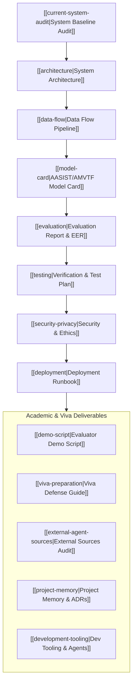

# VoxGuard AI — Master Knowledge Graph Index

Welcome to the VoxGuard AI knowledge vault. This graph documents the forensic deepfake audio detection architecture, data pipelines, API services, database models, and operational tooling.

---

## Complete B.Tech Major Project Deliverables

### 1. Architecture & Design
- [[current-system-audit|Current System Audit]]: Baseline analysis of working components, real vs. simulated flows, and integration points.
- [[architecture|System Architecture Overview]]: Multi-tier topology, presentation tier, FastAPI backend, and AMVTF inference engine.
- [[data-flow|End-to-End Data Flow Pipeline]]: Sequence diagrams from local audio ingest to VAD, STFT spectrogram, and Resend alert.
- [[architecture/database-schema|Database Schema Documentation]]: SQLite schema, `calls` table, and migrations.

### 2. Machine Learning, Metrics & Evaluation
- [[model-card|AASIST/AMVTF Machine Learning Model Card]]: Datasets, 12 physical acoustic features, operating boundaries, and ethical disclaimer.
- [[evaluation|Model Evaluation & Benchmark Report]]: 93.1% CV accuracy, 5.4% EER, confusion matrices, and threshold trade-offs.
- [[testing|Verification & Testing Protocol]]: Test case matrix (TC-001 through TC-008), automated test commands, and regression rules.

### 3. Security, Ethics & Operations
- [[security-privacy|Security, Privacy & Ethics Architecture]]: Zero-leak policy, voiceprint consent, right-to-erasure, and human-in-the-loop safeguards.
- [[deployment|Deployment & Runbook Guide]]: Local setup, Docker multi-container, Render backend, and Vercel frontend guides.
- [[development-tooling|Development Tooling Guide]]: Context7, Chrome DevTools, DBHub, Serena, shadcn/ui, and CodeMem memory.

### 4. Academic Presentation & Defense
- [[demo-script|Project Evaluator & Viva Demo Script]]: Step-by-step walkthrough covering audio preview, evidence spectrogram, call history, and alert test.
- [[viva-preparation|B.Tech Viva Voce Defense Guide]]: 10 high-probability examiner questions with rigorous mathematical and acoustic answers.
- [[external-agent-sources|External Agent Reference Audit]]: Governance log for `awesome-agents`, `ecc`, `agency-agents`, and `i-have-adhd`.
- [[project-memory|CodeMem Project Memory Synthesis]]: Chronological work log, Architecture Decision Records (ADRs), and known boundaries.
