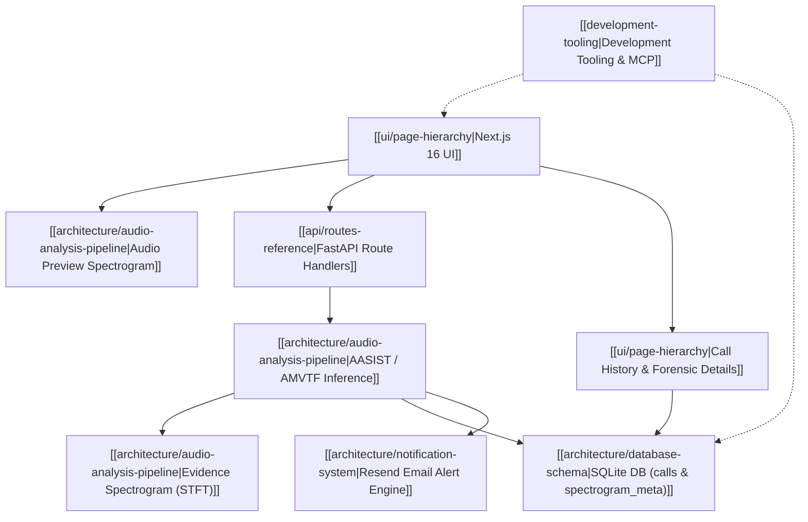

# VoxGuard AI — Obsidian Knowledge Graph Index

Welcome to the VoxGuard AI knowledge vault. This graph documents the forensic deepfake audio detection architecture, data pipelines, API services, database models, and operational tooling.

---

## Knowledge Map of Content (MOC)

### 1. Architecture & Core Systems
- [[architecture/system-overview|System Architecture Overview]]: Monorepo architecture, Next.js frontend, and FastAPI backend microservice.
- [[architecture/audio-analysis-pipeline|Audio Analysis & Forensic Pipeline]]: Dual-mode spectrogram architecture (Web Audio preview vs. backend STFT evidence).
- [[architecture/database-schema|Database Schema Reference]]: SQLite tables, `calls` entity, indexes, migrations, and retention policies.
- [[architecture/notification-system|Notification & Alerting System]]: Incident escalation, Resend email dispatch, and SOC recipient management.

### 2. Interfaces & APIs
- [[ui/page-hierarchy|UI Page Hierarchy & Component Catalog]]: Dashboard, Live Analysis, Call History, Identities, Settings, and shadcn/ui components.
- [[api/routes-reference|API Routes Reference]]: REST endpoints, WebSocket streaming channels, and JSON payloads.

### 3. Developer Tooling & Integrations
- [[development-tooling|Development Tooling Guide]]: Context7, Chrome DevTools, DBHub, Serena, shadcn/ui, CodeMem, and specialized agent personas.
