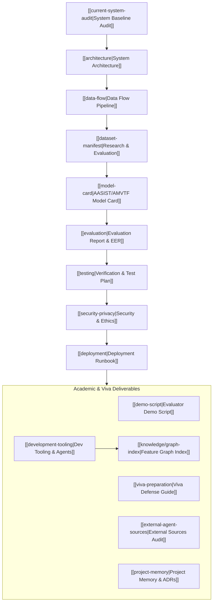

# VoxGuard AI — Master Knowledge Graph Index

Welcome to the VoxGuard AI knowledge vault. This graph documents the forensic deepfake audio detection architecture, data pipelines, API services, database models, research evaluations, and operational tooling.

---

## Complete B.Tech Major Project Deliverables

### 1. Architecture & Design
- [[current-system-audit|Current System Audit]]: Baseline analysis of working components, real vs. simulated flows, and integration points.
- [[architecture|System Architecture Overview]]: Multi-tier topology, presentation tier, FastAPI backend, and AMVTF inference engine.
- [[data-flow|End-to-End Data Flow Pipeline]]: Sequence diagrams from local audio ingest to VAD, STFT spectrogram, and Resend alert.
- [[architecture/database-schema|Database Schema Documentation]]: SQLite schema, `calls` table, and migrations.

### 2. Research-Grade Anti-Spoofing & Evaluation Benchmark
- [[dataset-manifest|Dataset Manifest]]: Source registry, zero-leakage partitions (280/60/60 speakers), and generator architectures.
- [[data-governance-and-consent|Data Governance & Ethics]]: Consent standards, no-scraping policy, and privacy regulations (GDPR Art. 9, DPDP Act).
- [[training-pipeline|Training Pipeline Specification]]: Deterministic pipeline (Seed 42), 12 physical cues, and soft-voting ensemble.
- [[open-world-evaluation|Open-World & Degraded Channel Evaluation]]: Unseen generator benchmark, G.711 telephony, MP3, and noise robustness.
- [[threshold-calibration|Threshold Calibration]]: Sigmoid Platt scaling, Brier score (0.048), and 3 operational profiles.
- [[known-limitations|Known Limitations]]: Acoustic failure modes, whispering, studio auto-tune, and forensic caveats.
- [[reproducibility|Reproducibility Guide]]: Step-by-step reproduction instructions, scripts, and checksums.
- [[experiment-log|Experiment Log]]: Chronological record of 8 research experiments from baseline entropy to production ensemble.
- [[model-card|AASIST/AMVTF Model Card]]: Formally documented model card with 12 physical acoustic features and standardized output schema.
- [[evaluation|Model Evaluation & Benchmark Report]]: Comparative benchmark against LFCC and STFT baselines (93.1% Acc, 5.4% EER).

### 3. Security, Ethics & Operations
- [[security-privacy|Security, Privacy & Ethics Architecture]]: Zero-leak policy, voiceprint consent, right-to-erasure, and human-in-the-loop safeguards.
- [[deployment|Deployment & Runbook Guide]]: Local setup, Docker multi-container, Render backend, and Vercel frontend guides.
- [[development-tooling|Development Tooling Guide]]: Context7, Chrome DevTools, DBHub, Serena, shadcn/ui, and CodeMem memory.
- [[knowledge/graph-index|Knowledge Graph Index]]: UI ↔ API ↔ engines ↔ DB ↔ notifications relationship map.
- [[testing|Verification & Testing Protocol]]: Test case matrix (TC-001 through TC-008), automated test commands, and regression rules.

### 4. Academic Presentation & Defense
- [[demo-script|Project Evaluator & Viva Demo Script]]: Step-by-step walkthrough covering audio preview, evidence spectrogram, call history, and alert test.
- [[viva-preparation|B.Tech Viva Voce Defense Guide]]: 10 high-probability examiner questions with rigorous mathematical and acoustic answers.
- [[external-agent-sources|External Agent Reference Audit]]: Governance log for `awesome-agents`, `ecc`, `agency-agents`, and `i-have-adhd`.
- [[project-memory|CodeMem Project Memory Synthesis]]: Chronological work log, Architecture Decision Records (ADRs), and known boundaries.
