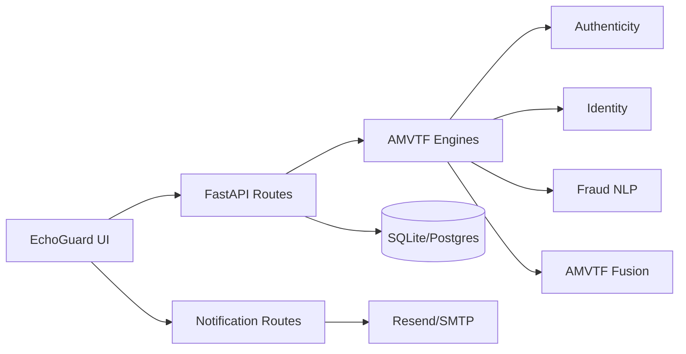

# Knowledge Graph Index (Obsidian / Graphify-friendly)

Wiki-style links for Obsidian graph view. **No secrets, no audio, no transcripts.**

## UI pages

| Page | Path | Related |
|------|------|---------|
| Live Analysis | `echoguard/src/app/page.tsx` | [[../api/routes-reference]], [[../architecture/audio-analysis-pipeline]], [[../development-tooling]] |
| Call History | `echoguard/src/app/call-history/page.tsx` | [[../architecture/database-schema]], spectrogram evidence |
| Identities | `echoguard/src/app/identities/page.tsx` | voice_profiles, ECAPA path |
| Settings | `echoguard/src/app/settings/page.tsx` | thresholds, keys, billing UI |
| Login | `echoguard/src/app/login/page.tsx` | sessions, auth |
| Notifications API (Next) | `echoguard/src/app/api/notifications/*` | [[../architecture/notification-system]] |

## Backend services / routes

| Area | Path | Notes |
|------|------|-------|
| Health | `GET /api/health` | Honest model labels |
| Analyze upload/live | `backend/routers/analyze.py` | Auth required |
| Live WS inference | `WS /ws/live-analyze` | Token query param |
| Demo WS | `WS /ws/audio-stream` | Simulated |
| Auth | `backend/routers/auth.py` | |
| Calls | `backend/routers/calls.py` | |
| Identities | `backend/routers/identities.py` | |
| Settings | `backend/routers/settings.py` | |
| Keys / billing | `backend/routers/keys.py` | Demo payment gates |
| Notifications | `backend/routers/notifications.py` | |

## Model / audio pipeline

| Node | Path | Truth |
|------|------|-------|
| Authenticity | `backend/engines/aasist.py` | Heuristics ± sklearn SoftVoting (not Jung GNN) |
| Preprocess | `backend/engines/audio_preprocess.py` | Shared 16 kHz mono |
| Detector interface | `backend/engines/detector_interface.py` | sklearn + torch stub |
| Live session | `backend/engines/live_session.py` | EMA + captions |
| Identity | `backend/engines/ecapa.py` | FFT 192-d projection |
| NLP | `backend/engines/nlp.py` | ASR + keyword risk |
| Fusion | `backend/engines/amvtf.py` | Acoustic ≠ fraud language |
| Spectrogram | `backend/engines/spectrogram.py` | STFT evidence |

## Database entities

See [[../architecture/database-schema]]: `users`, `sessions`, `calls`, `voice_profiles`, `settings`, `api_keys`, `payment_orders`, `notification_jobs`, `schema_migrations`.

## External integrations

| Integration | Role | Secrets |
|-------------|------|---------|
| Resend / SMTP | Alerts | Env only |
| Context7 | Dev docs MCP | `CONTEXT7_API_KEY` |
| Chrome DevTools MCP | Dev browser QA | Local Chrome |
| DBHub / DBCode | Dev DB inspect | `DBHUB_DSN` / extension |
| Serena | Dev code intel | Local `uvx` |
| Render / Vercel | Deploy | Host dashboards |

## Memory & tooling

- [[../project-memory]] / `.agents/memory/`
- [[../development-tooling]]
- `.agents/AGENT_REGISTRY.md`
