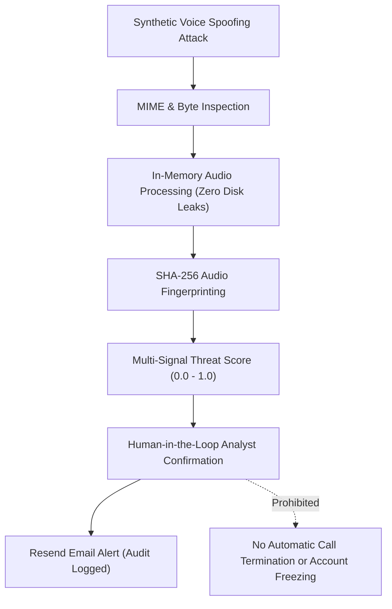

# VoxGuard AI — Security, Privacy & Ethics Architecture

## 1. Security Principles & Threat Modeling
VoxGuard operates under defense-in-depth principles tailored for mission-critical security operations:

---

## 2. Secrets Management & Environment Isolation
1. **Zero Client Secrets**:
   - Variables prefixed with `NEXT_PUBLIC_` are strictly non-sensitive (e.g. `NEXT_PUBLIC_API_URL`).
   - Sensitive keys (`RESEND_API_KEY`, `SECRET_KEY`, `DATABASE_URL`) exist exclusively in server-side configuration (`backend/.env` or Next.js server runtime).
2. **Repository Protection**:
   - Both `.env` and `.env.local` are enforced in `.gitignore`.
   - The repository ships with an updated, placeholder-only `.env.example`.

---

## 3. Biometric Privacy & Voiceprint Consent Management
- **Informed Consent**: Biometric enrollment (`/identities`) requires explicit operator acknowledgment and subject authorization.
- **Protected Vector Storage**: Voiceprints are stored as anonymized embedding arrays rather than raw audio files.
- **Revocation & Right to Erasure**: Operators can delete enrolled identities instantly, removing all stored embeddings from the `voice_profiles` table.
- **Data Minimization**: Ingested audio buffers are processed in memory and released upon inference completion; only generated STFT spectrogram images and metadata are stored in the historical audit log.

---

## 4. Human-in-the-Loop Ethical Safeguards
> **Mandatory Policy Standard**:
> No AI model is infallible. An authenticity score below 50% or a synthetic risk score above 70% must **never** trigger autonomous punitive actions, account suspension, or irreversible call termination.
- **SOC Analyst Triage**: Scores are presented as evidentiary guidance on the dashboard.
- **Audit Logging**: Any escalation, status override, or alert dispatch records the operator ID, timestamp, and incident rationale in the `calls` table.
- **Uncertainty Transparency**: Recordings that fail minimum length or quality criteria display an explicit `INCONCLUSIVE` verdict with clear acoustic rationale rather than guessing a binary classification.
