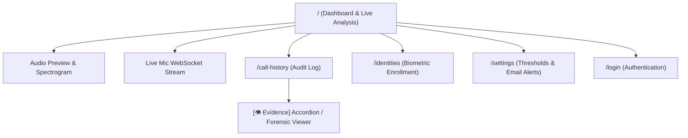

# UI Page Hierarchy & Components

VoxGuard’s frontend is constructed with Next.js 16 (App Router), Tailwind CSS v4, and accessible shadcn/ui components adhering to the dark-navy/orange SOC theme.

## Page Map

## Component Library (`src/components/ui/`)
- `card.tsx`: Dark container cards with subtle borders.
- `button.tsx`: High-contrast action triggers with focus rings.
- `badge.tsx`: Verdict markers (`AUTHENTIC`, `SUSPICIOUS`, `DEEPFAKE`).
- `dialog.tsx`: Accessible modal dialogs powered by `@base-ui/react`.
- `tabs.tsx`: Accessible view switchers.
- `tooltip.tsx`: Accessible contextual hover hints.
- `table.tsx`: Structured log tables.

## Related Documents
- [[../architecture/system-overview|System Architecture]]
- [[../development-tooling|UI Quality Agent]]
